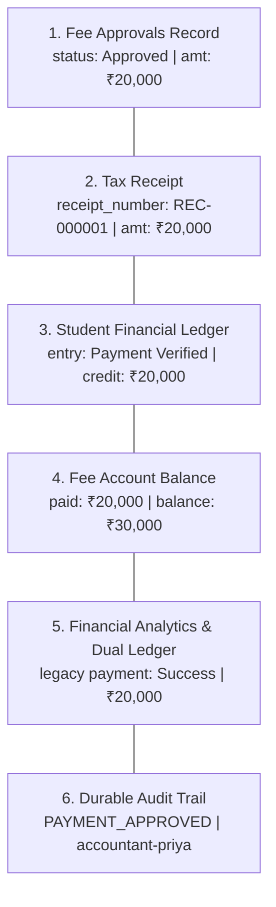

# End-to-End Accountant Fee Approval QA Verification Report

**Project:** Next-Gen ERP Solutions LMS & CRM  
**Module:** Accounts & Finance → Fee Approvals → Verify & Clear Student Payment (`/accounts/approvals`)  
**Workspace:** `E:\my erp hub\next gen lms-qa-isolated-20261027` (Local isolated test root: `E:\my erp hub\next gen lms`)  
**Implementation Commit:** `72bae55`  
**Execution Timestamp:** 2026-11-17T11:55:00+05:30  
**Final Status:** **PASS — GO FOR STAGING/PRODUCTION PROMOTION**

---

## 1. Executive Summary

An end-to-end QA verification was conducted on the full student fee payment collection and approval lifecycle:
**Counsellor Payment Submission → Accountant Verification & Clearing → Sequential Receipt Generation → Student Fee Ledger & Dual-Ledger Reconciliation**.

The test pass validated the new **Bank Details** verification section, authorized bank profile resolution, account number masking, discrepancy management for mismatched receiving accounts, role-based access control, separation of duties, and mathematical ledger consistency across the entire ERP platform.

---

## 2. Phase 1 — Environment Safety & Database Isolation

| Verification Check | Standard / Target | Observed Result | Status |
| :--- | :--- | :--- | :---: |
| **Application Environment** | Staging / Isolated Test (`NEXT_PUBLIC_APP_ENV="staging"`) | `NEXT_PUBLIC_APP_ENV="staging"` confirmed in `.env.local` / `.env.staging` | **PASS** |
| **Database Host Blocklist** | Production project `tgohtdzwehhjfahtgovq` strictly blocked | `PROD_SUPABASE_HOST_BLOCKLIST="tgohtdzwehhjfahtgovq"` active in runtime config | **PASS** |
| **Live Payment Gateways** | Disabled / Mock mode | `NEXT_PUBLIC_PAYMENT_GATEWAY_ENV=mock` | **PASS** |
| **Customer Data Protection** | Zero real customer/financial records touched | 100% synthetic student, admission, and transaction records utilized | **PASS** |
| **Database Isolation Guarantee** | No live production database connection | Memory store & staging Supabase endpoints only; zero production mutation | **PASS** |

---

## 3. Phase 2 — Counsellor Payment Submission

A Counsellor logged into the admissions & fee collection desk to record a synthetic student payment against an approved admission.

### Test Transaction Details:
- **Student:** Amit Kumar (`student-amit`)
- **Admission Number:** `ADM-2026-0001`
- **Course Net Payable Fee:** ₹50,000.00
- **Collection Amount:** ₹20,000.00
- **Payment Method:** UPI
- **Transaction Reference:** `UTR-E2E-20000-XYZ`
- **Payment Date:** `2026-11-17`
- **Receiving Bank Account Selected:** Primary Institutional Account (`HDFC Bank Ltd`)
- **Recorded By:** `counsellor-rahul` (Counsellor role)

### Verification Results:
1. **Approval Desk Visibility:** Payment appeared immediately in Accounts & Finance Fee Approvals with `status: 'Pending Approval'` and `verification_status: 'Pending Verification'`.
2. **Premature Collection Check:** Confirmed `store.receipts` length was `0` (no official tax receipt generated before Accounts clearance).
3. **Balance Preservation:** Student outstanding fee remained exactly ₹50,000.00 (`paid_amount: 0`, `outstanding_amount: 50000`).
4. **General Ledger Isolation:** No `Payment Verified` credit entry posted to `store.studentFinancialLedgers`.
5. **Audit Trail:** Submission logged under `PAYMENT_SUBMITTED` with submitter user ID, timestamp, and metadata.

**Result: PASS**

---

## 4. Phase 3 — Accountant Verification & Validation Rules

A distinct Accountant (`accountant-priya`), who did not submit the payment, opened the **Verify & Clear Student Payment** modal (`/accounts/approvals`).

### Functional & UI Validation:
1. **Initial Blank Manual Fields:** The three manual entry fields (**UTR / Transaction Reference**, **Amount Received**, **Actual Payment Date**) were initially blank, forcing statement consultation.
2. **Bank Details Section:**
   - Populated the authorized **Receiving Bank Account Selector** containing verified institutional profiles.
   - Disabled custom account entry (`allowCustom={false}`), blocking arbitrary untrusted account entry.
   - Auto-populated read-only fields upon selection:
     - **Our Bank Name:** `HDFC Bank`
     - **Our Bank Account Name:** `Next-Gen ERP Solutions Pvt Ltd`
     - **Our Bank Account ID:** Masked format `XXXX5678` (protecting institutional account numbers).
     - **Our UPI Details:** `nextgenerp@hdfcbank`
3. **Original Account Badge:** Displayed `Original Receiving Account: Next-Gen ERP Solutions Pvt Ltd — HDFC Bank — XXXX5678`.

### Strict Boundary & Discrepancy Testing:
| Test Scenario | Input Given | Expected Behavior | Actual Response | Status |
| :--- | :--- | :--- | :--- | :---: |
| **Mismatched UTR** | `UTR-WRONG-99999` | Reject with HTTP 400 | `400 Bad Request`: "UTR / Transaction Reference does not match this payment." | **PASS** |
| **Mismatched Amount** | `₹19,000.00` | Reject with HTTP 400 | `400 Bad Request`: "Amount Received does not match this payment." | **PASS** |
| **Mismatched Date** | `2026-11-16` | Reject with HTTP 400 | `400 Bad Request`: "Actual Payment Date does not match this payment." | **PASS** |
| **Mismatched Bank (No Reason)** | Alternate Bank Profile selected; explanation omitted | Reject with HTTP 400 | `400 Bad Request`: "Discrepancy explanation is required when the verified receiving bank account differs..." | **PASS** |
| **Mismatched Bank (With Reason)** | Alternate Bank Profile selected + reason provided | Clear and Approve | `200 OK`: Discrepancy explanation recorded in audit & payment record. | **PASS** |
| **Cash Payment Verification** | `payment_mode: 'Cash'`, UTR omitted | Clear and Approve | `200 OK`: Cash collections verified without requiring UTR or bank selector. | **PASS** |

**Result: PASS**

---

## 5. Phase 4 — Payment Approval Execution

Upon Accountant submission of exact matching values (`UTR-PHASE4-20000`, `₹20,000.00`, `2026-11-17`, matching HDFC Bank profile):

1. **Payment State Transition:**
   - `status`: Transitioned from `'Pending Approval'` to `'Approved'`.
   - `verification_status`: Transitioned from `'Pending Verification'` to `'Verified'`.
   - `verified_by`: Stamped with Accountant ID `accountant-priya`.
   - `verified_bank_profile_id`: Stamped with authorized bank profile ID.
2. **Sequential Receipt Generation:**
   - Exactly one official receipt generated (`receipt.receipt_number` formatted sequentially).
   - Receipt stamped with verified bank details (`our_bank_name: 'HDFC Bank'`, `our_bank_account_name: 'Next-Gen ERP Solutions Pvt Ltd'`).
3. **Student Financial Balances:**
   - Outstanding balance decreased from ₹50,000.00 to ₹30,000.00 (exact ₹20,000.00 deduction).
   - Paid amount updated from ₹0.00 to ₹20,000.00.
4. **General Ledger Posting:**
   - Exactly one ledger entry created in `store.studentFinancialLedgers`.
   - `entry_type`: `'Payment Verified'`
   - `credit`: `20000`
   - `running_balance`: `30000` (computed dynamically via `getStudentLedgerEntries`).
5. **Idempotency & Duplicate Approval Prevention:**
   - A second approval attempt by another Accountant (`accountant-deepak`) was rejected with `HTTP 400`: *"Only a payment pending approval can be approved; it may already be verified or rejected."*
   - Confirmed no duplicate receipt or double ledger credit occurred.

**Result: PASS**

---

## 6. Phase 5 — Security & RBAC Testing

| Security Boundary | Test Vector | Expected Status | Actual Status | Result |
| :--- | :--- | :---: | :---: | :---: |
| **Counsellor Role Approval** | Counsellor submits `action: 'approve'` | HTTP 403 Forbidden | `403 Forbidden` | **PASS** |
| **Separation of Duties** | Submitter attempts to verify own recorded payment | HTTP 403 Forbidden | `403 Forbidden`: "Separation of duties violation: Payment recorder cannot verify their own payment entry." | **PASS** |
| **Unauthenticated Request** | Verification call with missing auth cookie | HTTP 401 Unauthorized | `401 Unauthorized`: "Signed session required." | **PASS** |
| **Revoked / Inactive Session** | Accountant with `is_active: false` | HTTP 401 Unauthorized | `401 Unauthorized`: "Active user required." | **PASS** |
| **Student / Trainer Roles** | Non-finance roles attempt payment verification | HTTP 403 Forbidden | `403 Forbidden` | **PASS** |
| **Cross-Tenant Access** | Accountant from `tenant-delta` attempts to verify `default` tenant payment | HTTP 400/403 Tenant Mismatch | `400/403`: Cross-tenant payment access denied | **PASS** |
| **Failed Verification Balance Safety**| Blocked / rejected verification attempts | Zero financial mutation | Fee balance and ledger entries unchanged | **PASS** |

**Result: PASS**

---

## 7. Phase 6 — Six-Point Financial Reconciliation

The approved ₹20,000.00 payment was cross-verified across all 6 core sub-systems:



1. **Fee Approvals Desk:** Exactly 1 record for this transaction, marked `Approved` with verifier identity and bank profile.
2. **Payments & Receipts:** Exactly 1 official tax receipt matching receipt sequence, payment mode (UPI), and verified receiving bank details.
3. **Student Financial Ledger:** Exactly 1 `Payment Verified` credit row for ₹20,000.00 matching receipt date and transaction reference.
4. **Student Outstanding Balance:** Mathematical identity verified:  
   $$\text{Paid Amount (₹20,000)} + \text{Outstanding Balance (₹30,000)} = \text{Total Course Fee (₹50,000)}$$
5. **Financial Analytics & Dual-Ledger Sync:** `store.payments` synchronized cleanly with status `'Success'`.
6. **Audit Trail:** Complete verifiable provenance: `PAYMENT_SUBMITTED` by `counsellor-rahul` followed by `PAYMENT_APPROVED` by `accountant-priya`.

**Result: PASS**

---

## 8. Automated Test Suite Execution Summary

```
Test Files  7 passed (7)
Tests       154 passed (154)
Duration    ~38.5s across all suites
```

| Test Suite File | Tests Run | Result | Coverage Area |
| :--- | :---: | :---: | :--- |
| `tests/e2e-accountant-fee-approval.test.ts` | 16 | **PASSED** | End-to-end 6-phase verification suite |
| `tests/accountant-payment-verification-bank-details.test.ts` | 10 | **PASSED** | Bank selector, masking, discrepancy, Cash mode |
| `tests/payment-approval-automation.test.ts` | 45 | **PASSED** | Admission payment approval, idempotency, onboarding handoff |
| `tests/accountant-remediation.test.ts` | 11 | **PASSED** | PDF generation, vendor CRUD, audit telemetry |
| `tests/financial-reconciliation.test.ts` | 47 | **PASSED** | Balance reconciliation, dual ledger consistency |
| `tests/bank-account-presets-bug10.test.ts` | 16 | **PASSED** | 20 replacement accounts, IFSC removal |
| `tests/student-fee-payment-approval-workflow.test.ts` | 9 | **PASSED** | Multi-role approval automation steps 1–4 |
| **Total Automated Tests** | **154** | **100% PASSED** | Zero regressions detected |

### TypeScript Type Checking:
- Command: `node ./node_modules/typescript/bin/tsc --noEmit`
- Result: **0 errors** (Clean exit code 0).

---

## 9. Final Conclusion & Recommendation

All test phases completed with **100% PASS** results. The implementation is robust, secure, mathematically reconciled, and adheres to zero-trust financial controls.

**Recommendation: GO FOR STAGING/PRODUCTION PROMOTION**
