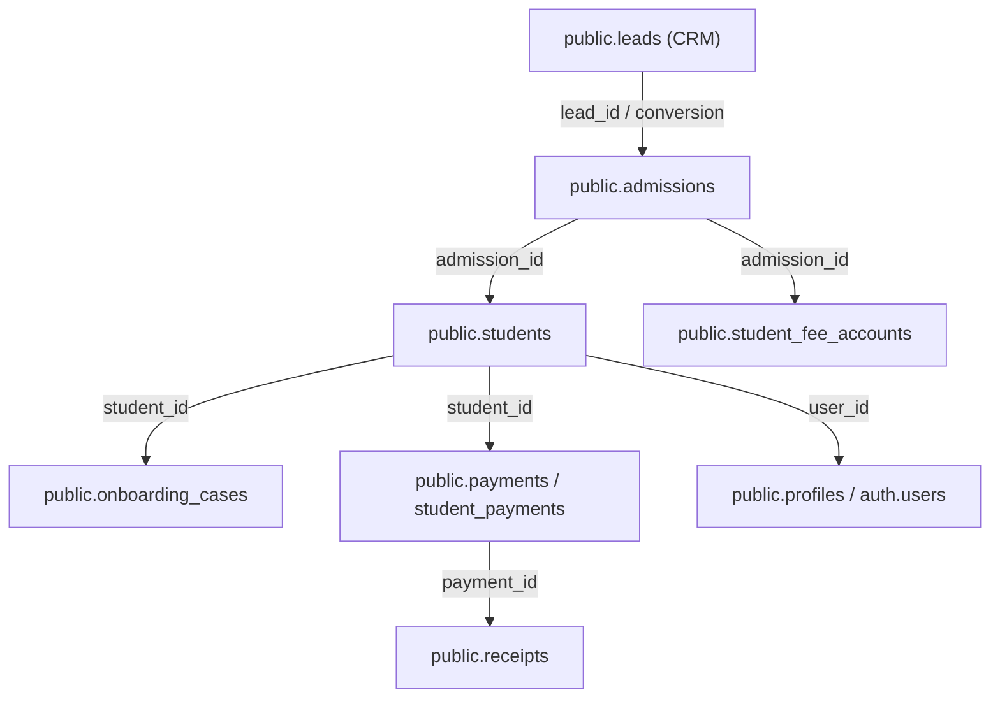

# Standard Operating Procedure (SOP): Safe Production Database Cleanup & Environment Maintenance

**Document ID:** SOP-OPS-DB-004  
**Classification:** High-Risk Database Operations  
**Scope:** PostgreSQL (`public` schema), Supabase, LMS & CRM Application Data  
**Target Environment:** Production (`next-gen-lms-omega.vercel.app`, DB: `tgohtdzwehhjfahtgovq`)  

---

## 1. Purpose & Guiding Principles

This SOP establishes mandatory safeguards to prevent asymmetric data loss, orphaned foreign keys, and relational discrepancies across CRM leads, admissions, academic records, and financial ledgers.

> [!CRITICAL]
> **Zero Uncoordinated Table Truncation:**
> No table containing relational dependencies may ever be truncated, deleted, or purged without simultaneously reconciling or archiving its parent, sibling, and child records.

---

## 2. Table Dependency Map & Impact Hierarchy



### Affected Domain Entities
1. **CRM & Marketing:** `public.leads`, `public.lead_followups`, `public.lead_timeline`
2. **Admissions:** `public.admissions`
3. **Academics & Students:** `public.students`, `public.batches`, `public.courses`
4. **Finance & Accounts:** `public.student_fee_accounts`, `public.student_fees`, `public.fee_installments`, `public.payments`, `public.student_payments`, `public.receipts`
5. **Onboarding & Support:** `public.onboarding_cases`, `public.student_onboarding`
6. **Platform & Auth:** `public.profiles`, `auth.users`, `public.audit_logs`

---

## 3. Mandatory 14-Step Cleanup Procedure

### Step 1: Pre-Cleanup Record Inventory & Snapshot
Before any cleanup script is staged, record exact row counts across all tables:
```sql
SELECT 
  'leads' AS tbl, count(*) FROM public.leads
UNION ALL SELECT 'admissions', count(*) FROM public.admissions
UNION ALL SELECT 'students', count(*) FROM public.students
UNION ALL SELECT 'payments', count(*) FROM public.payments
UNION ALL SELECT 'receipts', count(*) FROM public.receipts
UNION ALL SELECT 'onboarding_cases', count(*) FROM public.onboarding_cases;
```

### Step 2: Database Backup Verification
1. Initiate an automated and manual backup via Supabase Dashboard / CLI:
   ```bash
   supabase db dump -f pre_cleanup_backup_$(date +%Y%m%d_%H%M%S).sql
   ```
2. Verify backup file size, non-empty schema tables, and checksum.
3. Confirm point-in-time recovery (PITR) window is active.

### Step 3: Foreign-Key Relationship & Dependency Validation
Scan for existing foreign keys and dependent constraints:
```sql
SELECT conname, conrelid::regclass, confrelid::regclass 
FROM pg_constraint 
WHERE confrelid = 'public.admissions'::regclass;
```

### Step 4: CRM Conversion Status Reconciliation
- Identify every lead marked `'Converted'` or `'Enrolled'`.
- If an admission is to be removed, determine whether the lead should:
  - Transition to `conversion_status = 'historical'` with `archival_reason` set.
  - Revert to `stage = 'Follow-up'` or `stage = 'Demo Attended'` if the test conversion was void.
  - **Never leave a lead marked Converted while deleting its admission without an archival audit trail.**

### Step 5: Student Profile & Academic Reconciliation
- If student records are removed, ensure any batch enrollment counters (`batches.current_enrolled`) are decremented.
- Ensure LMS credentials and portal accounts are deactivated or safely dissociated.

### Step 6: Financial Ledger & Payment Reconciliation
- Verify all pending or approved payments linked to target students.
- Zero-rupee vouchers, cash receipts, and transaction references must be archived to an audit archive before primary ledger deletion.

### Step 7: Onboarding Case Deactivation
- Remove or archive open onboarding tasks and tickets to prevent orphan ticket queues.

### Step 8: LMS Portal & Auth Access Reconciliation
- Deactivate student credentials in `public.profiles` (`is_active = false`).

### Step 9: Dry-Run Execution & Impact Report
Execute the deletion within an uncommitted transaction:
```sql
BEGIN;
-- Perform proposed deletion
SELECT count(*) FROM ...;
-- Produce dry run summary
ROLLBACK;
```

### Step 10: Explicit Stakeholder & Administrator Approval
The dry-run report must be signed off by:
1. Super Admin
2. Operations / Admissions Lead
3. Finance / Accounts Lead

### Step 11: Transactional Execution (`BEGIN ... COMMIT`)
Execute in a single atomic database transaction:
```sql
BEGIN;
-- Archive leads conversion state
UPDATE public.leads 
SET conversion_status = 'historical', 
    archived_at = now(), 
    archival_reason = 'Scheduled test data cleanup'
WHERE id IN (...);

-- Safe cascade delete of target records
DELETE FROM public.payments WHERE student_id IN (...);
DELETE FROM public.students WHERE id IN (...);
DELETE FROM public.admissions WHERE id IN (...);

COMMIT;
```

### Step 12: Post-Cleanup Integrity Verification
Immediately query for orphaned records or integrity violations:
- Converted leads without admissions or archival records.
- Payments without students.
- Receipts without payments.
- Student fee accounts without students.

### Step 13: System Audit Logging
Log the cleanup event into `public.audit_logs`:
```sql
INSERT INTO public.audit_logs (action, module, record_id, payload, created_at)
VALUES ('DATABASE_CLEANUP_EXECUTED', 'OPERATIONS', gen_random_uuid(), '{"scope": "test_pilot_purge"}', now());
```

### Step 14: Emergency Rollback Procedure
If any discrepancy, application error, or unauthorized deletion occurs:
1. Immediately enable Maintenance Mode.
2. Restore database from the pre-cleanup dump (Step 2).
3. Notify stakeholders and file an Incident Post-Mortem.
