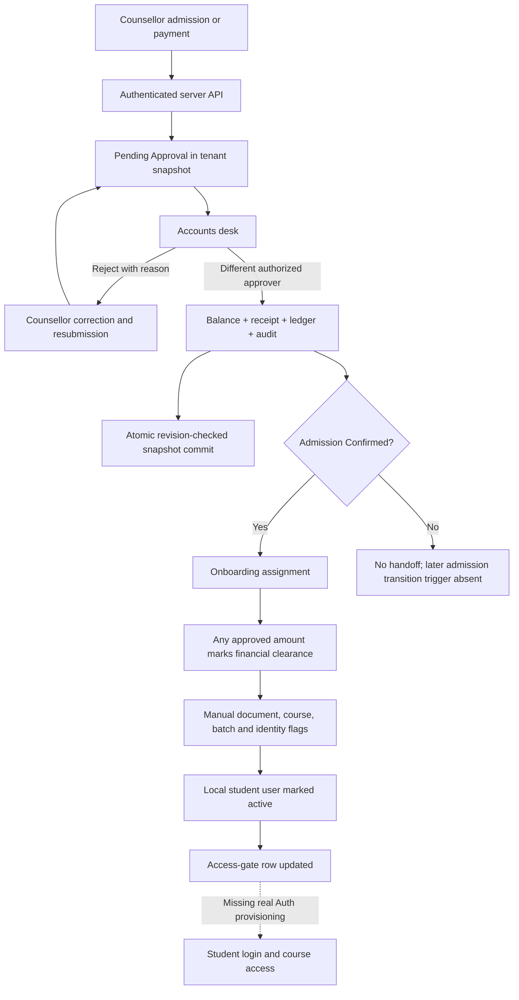
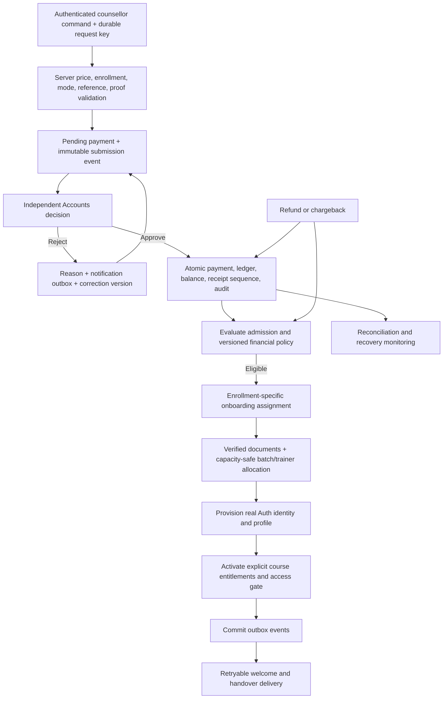

# Next Gen LMS — fee approval workflow audit

Date: 15 October 2026, Asia/Calcutta. Baseline: commit `1303baa` **plus the current uncommitted workspace changes**, including student-detail, portal, certificate and middleware changes. This is not a certification of the committed revision alone.

Scope: counsellor payment entry through Accounts approval, ledger, receipt, onboarding and student access; actual source, live Supabase metadata/state, authenticated API reads, isolated service/API tests and isolated PostgreSQL execution. Audit only: no live payments, refunds, admissions or onboarding transitions were created or changed. Existing test role accounts were used for sign-in and read/denial checks; their test sessions were signed out locally.

## 1. Executive summary

**Production decision: NO-GO for unrestricted real student/financial operations. Controlled staging testing is appropriate after the build failure is fixed.**

The primary payment approval path has real server authentication, actor/tenant checks, separation of duties, pending status, positive/precision checks, reference deduplication, balance checks, audit events, private uploads and transactional snapshot persistence. These are implemented and have meaningful tests. They do not establish a complete production workflow.

The most consequential findings are: counsellors can self-approve arbitrary admission discounts; any partial payment automatically clears the financial checklist without a policy threshold; LMS provisioning does not create a real Auth identity; receipt reversal remains a client-local operation; batch/document checks do not enforce underlying evidence; and live data is split between JSON workflow state and relational tables. The current production build and lint both fail.

Execution: **571 existing tests passed; 8 additional defect reproductions passed; TypeScript passed; isolated PostgreSQL checks passed; lint failed; production build failed.** Passing defect reproductions means the defects were reproduced, not fixed. A full browser-driven successful admission-to-student-login journey was **not** completed.

| Module | Status | Bugs | Missing features / connections | Priority |
|---|---|---|---|---|
| Counsellor Payment | Partial | B02, B08, B09 | Shared admission/payment validation, durable retry key | P0/P1 |
| Accounts Approvals | Core approval tested | B03; B10 downstream | Paging, escalation, policy-based clearance | P1 |
| Payment Ledger | Transactional snapshot; mixed persistence | B06, B07, B13 | Durable refund/reversal, relational reconciliation | P0/P1 |
| Receipt | Issue path tested; reversal incomplete | B07, B10 | Atomic credit-note API and sequence | P1 |
| Onboarding | Handoff implemented; checks incomplete | B03, B04, B05, B12, B14 | Real Auth provisioning and allocations | P0/P1 |
| RBAC / Tenant Isolation | Financial API mostly enforced | B11, B12 | Tenant-safe profile/handover access | P1 |
| Student LMS Access | Gate exists; lifecycle incomplete | B04, B05 | Auth identity, enrollment entitlement, revocation | P0 |
| Deployment / Student Detail | Blocked | B01 | Fix conditional Hook before release | P0 |

## 2. Existing implemented workflow

1. `/api/admissions` authenticates a live Supabase session and reads the authoritative profile. Counsellor/admin roles can create an admission. New admissions are immediately `Confirmed`; a fee is immediately `Approved`, and a local inactive student user is created.
2. An initial payment goes through `recordPayment`, or later payments go through `/api/fees/payments`. The dedicated payment endpoint validates mode, date, proof, amount and non-cash reference more strictly than the admission endpoint.
3. Manual payments receive `status: Pending Approval` and legacy `verification_status: Pending Verification`. No verified money or receipt is added at this point.
4. The approvals page refreshes the authenticated snapshot and displays payment method, reference, amount, date, proof and submitter. Search/status filters are implemented. The payments table maps all filtered records; it has no actual paging.
5. Approval requires an active Accounts/admin actor distinct from the recorder, same-tenant records, pending status and an affordable remaining balance. Rejection requires a reason. Correction/resubmission preserves audit history.
6. Approval updates the fee, account/student totals, legacy payment mirror, receipt and financial ledger, then audit/notifications and onboarding handoff.
7. `paymentTransaction` serializes operations in-process and writes a tenant snapshot through `commit_fee_workflow` with a revision compare-and-swap. The SQL function atomically commits the snapshot and student access gates. A stale writer or gate error rolls back that SQL transaction.
8. Confirmed admissions are handed to an existing/new onboarding case and assigned to an active same-tenant specialist. Other prerequisite flags must be completed before the service marks LMS access activated. Financial clearance is prematurely set by any approved payment.

## 3. End-to-end workflow diagram

## 4. Confirmed bugs

Paths and line numbers refer to the audited working tree. Isolated reproductions are in `tests/fee-workflow-audit-reproductions.test.ts` and deliberately assert current undesirable behavior.

### B01 — Production build fails on conditional React Hook

- **Severity:** High. **Module:** Student detail/build. **Affected role:** All deploys; student-management staff.
- **File and line:** `app/(dashboard)/students/[id]/page.tsx:345`; early returns occur before that Hook.
- **Expected:** Hooks run in a consistent order; production builds succeed.
- **Actual:** Lint and isolated `next build` fail with `react-hooks/rules-of-hooks` for conditional `React.useMemo`.
- **Steps:** Run `npm.cmd run lint` or `npm.cmd run build` on the current workspace.
- **Root cause:** `activityTimeline` Hook follows conditional returns.
- **Business impact:** Current release cannot be built; changing record availability can also break render order.
- **Recommended fix:** Move Hooks above all early returns or extract a child component with stable Hook order.
- **Suggested regression test:** Render missing/loading/present student transitions and require lint/build in CI.
- **Evidence:** Both commands were executed and failed on this exact error. This file is currently uncommitted relative to the baseline.

### B02 — Counsellor can self-approve arbitrary admission fee discounts

- **Severity:** Critical. **Module:** Admissions/fee authorization. **Affected role:** Counsellor, Accounts, Admin.
- **File and line:** `app/api/admissions/route.ts:10`; `lib/services/admission-service.ts:211`, `:337`, `:341`.
- **Expected:** Course prices and discount authority are validated server-side; exceptional discounts require an authorized independent approval.
- **Actual:** Request-controlled course fee/discount become a confirmed admission and approved fee, with the counsellor recorded as approver. A discount larger than the entire fee becomes a zero-payable approved fee.
- **Steps:** As a counsellor, submit a 30,000 course fee with a 40,000 discount. The schema accepts nonnegative numbers; the service clamps payable to zero and approves it.
- **Root cause:** Admission creation bypasses proposal approval and trusts client pricing; no discount ceiling or configured waiver policy is enforced.
- **Business impact:** Unauthorized fee waivers and inaccurate approved-revenue records without an Accounts decision.
- **Recommended fix:** Resolve price from a tenant course record; validate discounts against configured authority and require approval above threshold. Separate admission eligibility and financial approval.
- **Suggested regression test:** Reject excessive discounts, altered base prices and self-approved waivers via the actual admission API.
- **Evidence:** Isolated reproduction passed. No live fee was changed.

### B03 — Any partial payment grants full financial-check clearance

- **Severity:** High. **Module:** Payment-to-onboarding transition. **Affected role:** Accounts, Onboarding, Student.
- **File and line:** `lib/services/onboarding-service.ts:339`, `:347`, `:449`, `:613`.
- **Expected:** A partial payment may start onboarding, but financial clearance requires the configured deposit/installment policy.
- **Actual:** Approval of 1 against 30,000 marks `fee_clearance_verification.completed = true`, with 29,999 still outstanding. Activation checks only a verified payment plus flags, not a required minimum.
- **Steps:** Create a 30,000 admission; approve a 1 payment; inspect the onboarding checklist.
- **Root cause:** Verified-payment existence is treated as financial clearance; no threshold/policy evaluation exists here.
- **Business impact:** Students can satisfy the financial prerequisite with a nominal payment.
- **Recommended fix:** Separate “payment verified” from “financially eligible”; store policy/version and calculate required cleared amount server-side.
- **Suggested regression test:** Below/at/above deposit thresholds, overdue installments, scholarship and zero-fee admissions.
- **Evidence:** Isolated reproduction passed.

### B04 — LMS provisioning reports success without creating an Auth account

- **Severity:** High. **Module:** Student identity/activation. **Affected role:** New Student, Onboarding.
- **File and line:** `lib/services/admission-service.ts:219`; `lib/services/onboarding-service.ts:622`, `:634`, `:657`; `lib/services/payment-workflow-transaction.ts:68`.
- **Expected:** A newly activated student has an actual Supabase Auth identity, matching profile and enrollment link, and a usable login setup flow.
- **Actual:** Services create/activate a `store.users` entry with a synthetic `usr-stu-*` ID and mark the case activated. No Auth Admin create/invite call or corresponding native profile write is made by this path. The success text says credentials were dispatched.
- **Steps:** Register a new email, finish checks, activate, and compare snapshot user ID with `public.profiles` and Auth users.
- **Root cause:** Local user creation was treated as identity provisioning; snapshot persistence does not provision Supabase Auth.
- **Business impact:** “Activated” students cannot actually sign in; gate IDs do not match real authenticated UUIDs.
- **Recommended fix:** Provision a real identity through a secure server job, persist its ID to the student, update the actual profile, and activate only after successful provisioning. Use invite/password-setup links rather than fabricated credentials.
- **Suggested regression test:** Fresh email through real staging Auth, onboarding, password setup, sign-in and course entitlement.
- **Evidence:** Source confirmed; live snapshot has three student user IDs absent from native profiles. Full activation was not executed against live students.

### B05 — Document and batch checks can pass without documents or a batch

- **Severity:** High. **Module:** Onboarding verification. **Affected role:** Onboarding, Student.
- **File and line:** `lib/services/onboarding-service.ts:424`, `:449`, `:613`.
- **Expected:** Mandatory verification validates required documents and a valid, available, same-course batch/trainer allocation.
- **Actual:** `updateChecklistItem` accepts document/batch completion when documents are empty and `batch_id` is absent. Activation trusts these flags. No batch/trainer assignment operation is wired into this onboarding service.
- **Steps:** Approve a payment for a batchless admission; mark `document_verification` and `batch_allocation` complete.
- **Root cause:** Generic checklist toggles substitute for evidence/relationship validation.
- **Business impact:** Eligibility checks can be bypassed accidentally or intentionally; students can be marked ready without a cohort or required documents.
- **Recommended fix:** Validate evidence and assignment state during both checklist updates and activation, with audited exceptions if policy permits them.
- **Suggested regression test:** Missing/rejected documents, nonexistent/full/wrong-course batch, inactive trainer and changed assignments after checklist completion.
- **Evidence:** Isolated reproduction passed for both missing documents and batch.

### B06 — Installment requests are silently discarded

- **Severity:** High against the requested audit workflow. **Module:** Fee schedule/payments. **Affected role:** Counsellor, Accounts, Student.
- **File and line:** `lib/services/admission-service.ts:295`, `:333`; `lib/services/fee-workflow-service.ts:847`, `:1220`; `app/api/fees/payments/route.ts:23`.
- **Expected:** Existing/multiple installment obligations can be paid and reconciled, even if the admission plan selector is removed.
- **Actual:** Admission always uses Full Payment, generates zero installments, and records only `first_due_date`. The service ignores `installment_id`; the API does not include it in the accepted schema. Historical installment rows are deliberately left unchanged after approval.
- **Steps:** Request a three-installment admission or submit payment with an installment ID; inspect created schedule and payment linkage.
- **Root cause:** The current implementation changed to a single-balance model, beyond merely removing the UI selector.
- **Business impact:** Legacy installment balances/delinquency remain stale; the audit's installment requirement is not met.
- **Recommended fix:** Agree whether installments remain supported. If yes, retain backend schedules and atomically allocate approved payments; if no, formally migrate/retire legacy schedules and revise the business requirement.
- **Suggested regression test:** Partial installment, payment spanning installments, reversal allocation and legacy schedule migration.
- **Evidence:** Reproduction and existing tests explicitly demonstrate the discarded schedule/linkage. Repeated partial balance payments do work; they are not installment accounting.

### B07 — Receipt voiding is client-local and leaves conflicting payment status

- **Severity:** High. **Module:** Receipts/reversals. **Affected role:** Accounts, Admin, Student.
- **File and line:** `app/(dashboard)/accounts/receipts/page.tsx:113`; `lib/services/fee-workflow-service.ts:1559`, `:1570`, `:1602`, `:1625`.
- **Expected:** A reversal commits balances, payment status, credit note, audit and eligibility changes through an authorized transactional API.
- **Actual:** The page directly calls `feeWorkflowService.voidReceipt` in the browser, then fetches authoritative receipts again. There is no corresponding reversal API action. The service changes `verification_status` to Rejected but leaves `status` Approved; account lookup chooses the first account for a student. A missing actor is not denied by its conditional authorization check.
- **Steps:** Void a receipt from the UI and refresh; in an isolated service test, inspect both payment status fields after void.
- **Root cause:** Legacy browser mutation was not moved into the server workflow; reversal logic predates enrollment-specific accounts and canonical status.
- **Business impact:** Apparent reversals can disappear; balances can affect the wrong enrollment; status and access eligibility remain inconsistent. The missing-actor check is a service-layer defect, not proof of a remotely exploitable void endpoint.
- **Recommended fix:** Add a strict Accounts-only reversal API, immutable credit-note model, exact fee-account linkage, dual-status updates and financial eligibility recalculation in one transaction.
- **Suggested regression test:** Void → refresh → restart, wrong-tenant/unknown actor denial, multiple fee accounts, repeat void and revoked clearance.
- **Evidence:** Client/API source confirmed; conflicting status reproduced. No live receipt was voided.

### B08 — Admission initial payments bypass payment endpoint validation

- **Severity:** High. **Module:** Admission payment entry. **Affected role:** Counsellor, Accounts.
- **File and line:** `app/api/admissions/route.ts:10`, `:24`; `lib/services/admission-service.ts:396`; `app/api/fees/payments/route.ts:10`.
- **Expected:** All payment entry paths enforce valid mode, actual payment date, reference for non-cash payments and usable authorized proof.
- **Actual:** Admission uses a passthrough schema without the dedicated endpoint's payment-mode/date/reference validation. A UPI initial payment without a reference is saved. Payment date is forced to admission date. Both endpoints accept arbitrary HTTPS proof links or merely a private-path prefix without checking object existence/ownership at submission.
- **Steps:** Submit admission with initial UPI payment, no reference and an HTTPS proof placeholder; compare with a standalone payment request.
- **Root cause:** Duplicated, inconsistent input contracts and validation split across route/service layers.
- **Business impact:** Unreconcilable transactions, inaccurate historical payment dates and nonexistent/inaccessible evidence presented as valid proof.
- **Recommended fix:** Use a shared validated payment command; accept an owned upload identifier and verify it server-side. Capture actual payment date separately.
- **Suggested regression test:** Missing reference, invalid mode/date, future-date policy, nonexistent proof and cross-tenant proof reference through both entry routes.
- **Evidence:** Missing reference reproduced. Proof download itself still enforces tenant/owner restrictions; accepting a bad link does not prove cross-tenant download access.

### B09 — Admission retries can create duplicate enrollment/financial records

- **Severity:** High. **Module:** Admissions/idempotency. **Affected role:** Counsellor, Admin.
- **File and line:** `lib/services/payment-workflow-client.ts:45`; `app/api/admissions/route.ts:26`; `lib/services/admission-service.ts:180`, `:219`.
- **Expected:** Repeating the same admission after a timeout returns the original enrollment and initial payment.
- **Actual:** Admission has no idempotency token or request uniqueness constraint; every execution constructs new timestamp-based student/admission/account IDs. Initial payment also lacks the standalone request key. A retry without payment, or with unreferenced cash, can duplicate the registration.
- **Steps:** Replay the same valid no-payment admission request after its original response is lost.
- **Root cause:** Idempotency exists for standalone payment recording, not the larger admission transaction. Client payment retry keys also live only in memory and are lost on reload.
- **Business impact:** Duplicate student accounts, fees, seat usage and potentially duplicate cash entries.
- **Recommended fix:** Persist a tenant/actor/request idempotency record with payload hash for admission and payment; use UUID record identifiers and enrollment uniqueness rules.
- **Suggested regression test:** Drop the committed response, reload the browser, replay the request and confirm unchanged row counts.
- **Evidence:** Code-confirmed non-idempotent path. No duplicate live admission was submitted.

### B10 — Receipt numbering can collide with retained/imported numbers

- **Severity:** Medium. **Module:** Receipts. **Affected role:** Accounts, auditors.
- **File and line:** `lib/services/fee-workflow-service.ts:1159`.
- **Expected:** Unique, durable tenant/year receipt sequence independent of current array length.
- **Actual:** Next number is `receipts.length + 1`. A single retained receipt numbered `...000002` causes the next receipt to receive that same number.
- **Steps:** In isolated state retain one receipt ending 000002, then approve another payment.
- **Root cause:** Count-based numbering with no JSON-level unique constraint or sequence.
- **Business impact:** Duplicate receipt identifiers after imports/deletion/recovery; audit and lookup ambiguity. CAS prevents simultaneous snapshot overwrite but not this arithmetic collision.
- **Recommended fix:** Transactional per-tenant/year sequence plus unique constraint and immutable numbering history.
- **Suggested regression test:** Imported/gapped/year-crossing sequences and concurrent issue attempts.
- **Evidence:** Reproduced; current live receipt numbers showed no duplicates.

### B11 — Native profile RLS is not tenant-scoped

- **Severity:** High for multi-tenant rollout. **Module:** Profiles/RLS. **Affected role:** Staff and other tenants.
- **File and line:** `supabase/migrations/002_rls_policies.sql:44`, `:50`; `supabase/migrations/20261012094737_payment_approval_workflow.sql:2`.
- **Expected:** Ordinary staff can see authorized profiles only within their institute; cross-tenant super-admin access requires an explicit platform policy.
- **Actual:** Live `Staff can view staff profiles` policy checks only the caller role, not the target tenant or even target staff role. `Super Admins can manage all profiles` is similarly global. The workflow migration adds a profile tenant column but no restrictive profile tenant policy.
- **Steps:** In a two-tenant staging database, query profiles using a staff JWT from tenant A.
- **Root cause:** Tenant restrictions were added to financial/native student tables but not the existing profile read policy.
- **Business impact:** Cross-institute identity/contact exposure; potential broad profile management under platform-role ambiguity.
- **Recommended fix:** Tenant-scoped profile policies with a recursion-safe authoritative membership helper and explicitly defined platform-admin exception.
- **Suggested regression test:** Two-tenant staff/student/profile access matrix against real policies.
- **Evidence:** Actual live policy definitions inspected. No other tenant's personal records were fetched and no cross-tenant live exploit was attempted.

### B12 — Onboarding handover recipients are not tenant-scoped

- **Severity:** High. **Module:** Academic handover/notifications. **Affected role:** Onboarding, Trainer, Support, Admin.
- **File and line:** `lib/services/onboarding-service.ts:1071`, `:1142`.
- **Expected:** Only active authorized staff in the case's tenant receive student handover information.
- **Actual:** Fallback trainer is the first trainer in the shared store; support/admin recipient filtering has no tenant or active-user check.
- **Steps:** Load staff from two tenants into the server store and hand over a case without a resolved trainer.
- **Root cause:** Legacy notification recipient lookup does not use tenant membership.
- **Business impact:** Student names, course/batch and orientation information can be delivered to unrelated staff.
- **Recommended fix:** Scope every recipient and batch/trainer lookup by tenant and active status; fail with an actionable assignment error rather than choosing arbitrary faculty.
- **Suggested regression test:** Mixed-tenant process state; assert every notification recipient belongs to the case tenant.
- **Evidence:** Confirmed recipient-selection code. No actual emails/WhatsApp handovers were sent during this audit.

### B13 — Workflow and relational modules have different authoritative records

- **Severity:** High. **Module:** Persistence/module integration. **Affected role:** All roles, reports and integrations.
- **File and line:** `lib/services/payment-workflow-transaction.ts:30`, `:68`; `lib/services/payment-workflow-state.ts:5`; `docs/payment-approval-workflow.md` deployment notes.
- **Expected:** Admission/payment/onboarding data is consistent wherever supported modules read it.
- **Actual:** Commits update JSON state and access gates, not native admission/student/payment/receipt/onboarding tables. Live snapshot has 5 admissions/students/payments/receipts and 5 onboarding cases; native tables have 2/2/2/2 and 0 cases. The adapter documentation acknowledges this limitation.
- **Steps:** Compare snapshot collection counts with native table counts following a workflow admission/approval.
- **Root cause:** Transitional document-store adapter plus legacy direct-table integrations. Snapshot records use synthetic string IDs incompatible with native UUID relationships.
- **Business impact:** Native reports, Auth-linked student queries, integrations and legacy sync can miss or overwrite recent workflow records.
- **Recommended fix:** Choose a single supported source of truth. Prefer normalized transactional tables; otherwise migrate all readers/writers and implement durable, monitored projections before production.
- **Suggested regression test:** Cross-module read parity after commit, process restart and legacy sync; verify enrollment/profile IDs and totals.
- **Evidence:** Live read-only count comparison confirms divergence. JSON commit atomicity itself passed isolated PostgreSQL tests.

### B14 — External onboarding notifications run before transaction commit

- **Severity:** High when external delivery is configured. **Module:** Onboarding/transaction boundary.
- **Affected role:** Student, Onboarding, Accounts recovery staff.
- **File and line:** `lib/services/payment-workflow-transaction.ts:64`, `:68`; `lib/services/onboarding-service.ts:692`.
- **Expected:** Activation/welcome notifications are delivered only for committed transitions, exactly once or with an idempotent delivery key.
- **Actual:** The transaction awaits the service operation, which can send email/WhatsApp, before executing the revision-checked database commit. A later conflict rolls back local/DB state but cannot retract a delivered message.
- **Steps:** In isolated infrastructure, make notification delivery succeed and force the final commit to fail or conflict.
- **Root cause:** Network side effects are inside the pre-commit operation instead of a transactional outbox.
- **Business impact:** Students receive false activation confirmations; retries can duplicate notifications.
- **Recommended fix:** Write outbox events atomically with state and dispatch after commit with delivery deduplication/retry status.
- **Suggested regression test:** Inject commit failure after successful mock delivery and assert no real dispatch until a successful commit.
- **Evidence:** Ordering confirmed by source. External-delivery failure timing was not tested against real recipients.

## 5. Missing workflow connections

- A later admission approval/status change does not automatically retry onboarding handoff for an already-approved payment. Handoff is attached to payment approval; a recovery/backfill action is not an event-driven substitute.
- Onboarding displays course/batch/trainer details copied at case creation, but no complete transactional batch/trainer allocation step is implemented there. Updating a checklist is not seat allocation.
- Real Auth identity creation, profile activation and student enrollment linking are missing from the activation path (B04).
- Refund requests/processing exist in service code, but are not wired into the payment command API. `studentRefunds` is absent from `workflowKeys`, so merely wrapping those methods in the current transaction would not persist/roll back their request records.
- Fee revision request submission is exposed, but `approveFeeRevision` is not in the proposals API allowlist. End-to-end durable revision approval needs explicit wiring.
- Reversal/chargeback to financial-clearance re-evaluation and LMS restriction is missing.
- Multiple admissions for the same student may reuse the first student-level case (`onboarding-service.ts:267`) even when enrollment differs; native onboarding also has a unique student constraint. Define enrollment-specific onboarding before course transfers/re-enrollment.

## 6. Missing features and business-gap analysis

| Gap / edge case | Current behavior or evidence | Impact | Recommended solution |
|---|---|---|---|
| Partial fees | Multiple approved payments update balance; any amount clears onboarding | Deposit policy bypass | Versioned financial eligibility rules |
| Installments | New schedule disabled; old rows preserved unchanged | Incorrect installment aging | Restore allocation engine or formally migrate to single-balance policy |
| Duplicate references | Case-insensitive non-rejected reference checks exist | Good primary defense; alternate reference/edit edge cases need coverage | Normalize all reference fields and enforce uniqueness in authoritative DB model |
| Incorrect amount / overpayment | Positive two-decimal and outstanding checks exist | Good approval-path defense | Retain recheck at commit; test concurrent over-balance submissions |
| Correction / rejection | Pending/rejected corrections and reasons audited | Implemented | Add lost-response and cross-user regression coverage |
| Long-pending payment | In-app notification exists, no scheduled escalation found | Collections can stall | SLA aging queue, reminders and accountable escalation |
| Wrong-student approved payment | Input student/enrollment mismatch is rejected; no reassignment workflow | Unsafe ad hoc reversal workaround | Audited reverse-and-rebook transaction |
| Refunds / chargebacks | Incomplete durable flow | Unreliable outstanding and access status | Authorized settlement-linked reversal state machine |
| Held/cancelled admission | Verified payment can still credit an On Hold admission; no explicit collection policy | Money may be accepted for ineligible enrollment | Define allowed collection states; require override or refund handling |
| Course transfer / repeated enrollment | First-student account/case fallbacks remain in legacy paths | Misallocation and stale onboarding | Enrollment keys everywhere; transfer adjustment transaction |
| Zero-fee scholarship | Activation requires a verified positive payment | Legitimate fully waived student cannot follow normal activation | Approved scholarship clearance reason independent of payment existence |
| Lost response / reload | Standalone payment key is only in memory; admission has no key | Duplicate cash/admission risk | Durable request keys and outcome lookup |
| Failed receipt / handoff | Financial API operation is within rollback scope | Main state rollback exists; broad RPC failures appear as generic conflict | Preserve specific failure cause, retry guidance and recovery event |
| Manual recovery | Rollout notes and backfill exist; no comprehensive incident runbook | Inconsistent manual repair | Document reconcile/replay/outbox/gate recovery with dry-run and audit |
| Reconciliation reporting | Multiple representations; no enforced parity report | Hidden drift | Daily comparisons by enrollment, verified payment, receipt and credit note |

## 7. Database and data integrity

Live project inspected: `tgohtdzwehhjfahtgovq`; tenant snapshot `default`, revision 8 at inspection. See `2026-10-15-database-summary.json`.

- Snapshot: 5 students, 5 admissions, 5 fee accounts, 5 student fees, 5 legacy payments, 5 advanced payments, 5 receipts, 5 onboarding cases, 5 historical installments, 9 general audit entries and 63 onboarding audit entries.
- Native tables: 2 students/admissions/payments/receipts each; 0 onboarding cases. Three snapshot student user IDs are absent from native profiles.
- No duplicate advanced payment IDs, duplicate receipt numbers, orphan case student/admission references or fee-level arithmetic mismatches were found in this sample.
- Two advanced-payment-to-receipt exact-ID joins initially appeared missing. Follow-up confirmed both resolve through legacy `spr-` aliases and matching receipt numbers. **Do not report these as lost receipts.** Canonical relational IDs remain a recommended improvement.
- Snapshot JSON has no relational foreign keys or uniqueness constraints for its nested payments, receipt numbers, enrollments or proofs. The outer tenant primary key and revision constraint protect the snapshot row, not all business invariants.
- Live function metadata confirms `commit_fee_workflow` uses invoker security and authenticated clients lack EXECUTE permission. The profile-authority trigger function also uses invoker security.
- SQL commit atomically updates snapshot and access gates; stale revision and malformed gate update rollback passed actual isolated PostgreSQL execution. In-process queue also serializes reads across tenants and can create latency under load.
- The queue does not coordinate unrelated legacy direct-store writers. Only operations using this transaction wrapper receive its guarantees.
- Rollback restores only `workflowKeys`. Do not assume external calls, omitted collections or unrelated store mutations roll back.
- Native Accounts RLS still permits direct table payment/receipt/account edits. Those edits do not update authoritative JSON, producing another route for drift even where tenant boundaries hold.
- Migration history is transitional: old schema existed without recorded history; onboarding was staged under timestamp `20261012094736` while the repository file remains `006_onboarding_team_and_cases.sql`. Do not blindly push every migration; reconcile history against deployed schema first.

## 8. Authentication, RBAC and RLS

Live authentication uses `auth.getUser` plus a server-fetched active profile, not browser-supplied role/tenant metadata. Financial POST routes reject student/onboarding actors. Service approval enforces Accounts/admin role, separate recorder and same tenant. Existing tests executed for forged bearer identity, unsigned cookies, cross-tenant payment/proof access, unknown users and separation of duties.

Authenticated checks used a temporary audit server at `localhost:3105` because port 3000 was unavailable. See `2026-10-15-role-api-results.json`.

| Role | Payments GET | Receipts GET | Onboarding cases GET | Approve nonexistent payment | Direct snapshot SELECT |
|---|---:|---:|---:|---:|---:|
| Counsellor | 200 | 200 | 403 | 400: not found | 403 |
| Accountant | 200 | 200 | 403 | 400: not found | 403 |
| Onboarding Team | 200 | 403 | 200 | 403 | 403 |
| Admin | 200 | 200 | 200 | 400: not found | 403 |
| Super Admin | 200 | 200 | 200 | 400: not found | 403 |
| Student | 200, scoped | 200, scoped | 403 | 403 | 403 |

The nonexistent-ID probe proves safe failure, **not** that a counsellor can approve. Service tests separately verify counsellor approval rejection. No live valid-payment approval was attempted.

Private proof downloads validate path structure and hashed tenant/owner, and Accounts can view same-tenant proofs. Private storage denies direct client access; short-lived signed links are generated only after authorization. Upload validation uses filename, MIME and size rather than full file-content inspection. Actual browser upload/download and malware/content verification were not performed.

Remaining concerns: profile RLS (B11), cross-tenant handover recipients (B12), missing-gate behavior (middleware permits a student when no gate row exists, intentionally accommodating legacy users), native direct-write financial drift and browser-visible shared-store data outside scoped APIs. The missing-gate legacy exception needs an explicit migration and policy; it was not exploited in this audit.

The live Supabase security advisor at **error severity** returned no issues. This is not proof of business-rule or full tenant safety; the confirmed application defects above are outside that check's scope.

## 9. Fee calculation and financial risks

Core payment amount precision, nonpositive rejection, duplicate references, approval-time outstanding limits and one-time receipt/ledger posting are tested. GST removal is present in current receipt code/tests; no tax compliance conclusion is made here.

Highest financial risks are self-authorized admission pricing/discounts, partial-payment clearance, nondurable reversals and stale installment/native-table balances. Student-level totals should be reconciled across all enrollments, not overwritten from whichever account a legacy helper finds first. Receipt numbers need a sequence; immutable approval/reversal events need canonical references and verified uniqueness.

## 10. Onboarding transition issues

Initial handoff assigns active same-tenant staff and records assignment/audit/notification. Repeated approved-payment handoff reuses the case. This part is implemented.

Eligibility is nevertheless weakened because admission itself is auto-confirmed, fee clearance is any positive approved payment, document/batch verification is manual flagging, and activation is only a local user change. Active student record status is set at admission even while the user/access gate remains inactive, so dashboards can disagree about “Active.” Status vocabulary should distinguish Registered, Financially Eligible, Onboarding, Auth Provisioned and LMS Active.

Native SQL gate checks six checklist flags and `lms_account_created`. It does not independently verify payment policy, actual batch/document evidence or Auth identity. It therefore enforces the supplied application flags, not all business requirements.

## 11. UI/UX problems

- Approvals table lacks real pagination (`filteredPayments.map` at `app/(dashboard)/accounts/approvals/page.tsx:1396`). Large datasets load a full snapshot and render all matches.
- Payment and notification polling add round trips; there is no measured load/SLA result in this audit. The global transaction queue can amplify slow reads.
- Admission payment date is not independently captured; fee due date is not payment date.
- “Approved Discount” is a misleading label when the counsellor's input is automatically approved (B02).
- Receipt void success can be followed immediately by authoritative refresh restoring the unchanged receipt (B07).
- Activation messaging claims credentials were sent even though no real Auth provisioning occurs (B04).
- Plain browser alerts and generic conflict/configuration errors do not provide durable recovery/request IDs.
- Search/filter logic was inspected, but browser keyboard interaction, visual layouts, status-count correctness under simultaneous refresh, and file picker behavior are unverified.

## 12. Test execution results

| Check actually executed | Result | Limits |
|---|---|---|
| `npx.cmd tsc --noEmit` | PASS, exit 0 | Passed again after adding all eight audit reproduction tests |
| `npm.cmd run lint` | FAIL, exit 1 | Conditional Hook at student detail line 345; additional Hook/image warnings |
| Production `npm.cmd run build` in isolated same-drive source copy | FAIL, exit 1 | Failed on same Hook lint error; no successful production artifact claimed |
| `npx.cmd vitest run` | PASS: 41 files, 571 tests | Predominantly local service/API tests; not a browser/Supabase full journey |
| Additional isolated audit reproductions | PASS: 8 tests | Confirms current defects; not acceptance tests for desired behavior |
| `tests/payment-workflow-database.cjs` with temporary PGlite dependency | PASS | Executes migration, stale revision, rollback, gate, tenant RLS, profile authority and proof policy checks against simplified fixture schema |
| Six-role Supabase login/profile and local API checks | PASS for recorded read/denial expectations | No live successful financial writes or cross-tenant personal data reads |
| Live table/state consistency read | Completed | Found B04/B13 divergence; small dataset, not exhaustive reconciliation |
| Live security advisor, error level | No issues reported | Does not cover application business logic or all warning-level advisories |
| Full browser E2E | NOT EXECUTED | No browser automation tool/test harness available in this session |
| True multi-process concurrent live approvals / dropped commit response | NOT EXECUTED | Local concurrent approval and sequential SQL stale-revision checks ran, but they are not a full distributed race test |
| Real receipt PDF failure, provider outage, email/WhatsApp delivery and full onboarding/Auth activation | NOT EXECUTED | Would require controlled staging fixtures/providers and browser flow |

The unit suite has useful coverage for rejection/resubmission, partial amounts, duplicate approval, idempotent requests, rollback, tenant checks, notifications and blocked early activation. It also encodes some undesired policies: historical installments remaining unchanged, for example. Passing these tests is not evidence of meeting the audit's installment requirements.

### Proposed regression coverage

1. Real staging admission → proof upload → Accounts decision → receipt PDF → onboarding → Auth invitation → student login → only enrolled course access, with process/browser restarts.
2. Independent-process race on the same payment and on two payments exceeding one balance; one accepted outcome and deterministic conflict recovery.
3. Lose response after durable commit, reload and retry admission/payment with persisted idempotency key.
4. Two tenants and all six roles against both REST tables and application APIs, including profiles, proof references and handover notifications.
5. Pricing/discount tampering, missing mode/reference/date, foreign course/batch, blank proof and arbitrary URL on every entry path.
6. Policy-specific partial clearance, waived-fee enrollment, held/cancelled admission, refund, chargeback and post-activation financial reversal.
7. Multi-enrollment student with separate accounts, installments, cases, receipts, transfers and correct per-course entitlements.
8. Outbox provider failure, commit conflict and redelivery; no notification for rolled-back activation.
9. Receipt sequence import gaps/year rollover and legacy alias reconciliation; canonical IDs on all generated records.
10. Browser pagination/search/counts, proof accessibility, persistent errors and refresh behavior.

## 13. Prioritized fix recommendations

**P0 — before real production use:** Fix B01; close admission price/discount authorization B02; implement real student Auth/profile linking B04; decide authoritative persistence and correct affected module reads B13. Enforce evidence-backed activation B05 and financial policy B03 before enabling real student access.

**P1 — before finance acceptance:** Transactional server reversal/refund APIs B07, shared payment validation B08, durable admission/request idempotency B09, tenant-safe profiles and handover B11/B12, outbox B14, safe receipt numbering B10 and a decision/migration for installment support B06.

**P2 — operational completion:** Enrollment-specific transfers/onboarding, SLA escalation, reconciliation reports, pagination, request correlation and recovery runbooks. Run browser and staging failure-injection scenarios after fixes.

Do not repair live financial state by editing arbitrary JSON or replaying old seeds. First export a controlled backup, reconcile exact enrollment/payment/receipt identities, prepare an audited dry-run plan and apply validated changes through a consistent transaction model.

## 14. Proposed improved workflow

## 15. Production readiness assessment

The payment happy path is substantially implemented, but the complete business process is **not production-ready**. Current build failure alone blocks release; the identity, financial authorization, clearance, persistence and reversal defects independently block a safe full rollout.

Earlier “ready for a controlled live test” guidance must not be interpreted as production approval. This audit uses newer workspace changes and stricter evidence. Permit only controlled staging exercises until P0 issues are fixed and the full browser/Auth/financial journey passes with failure and concurrency cases.

Deliverables: this report, sanitized live database/API evidence JSON files, and eight isolated reproducible defect checks. No application fixes, migrations, live financial changes, commit or push were performed as part of this audit.
