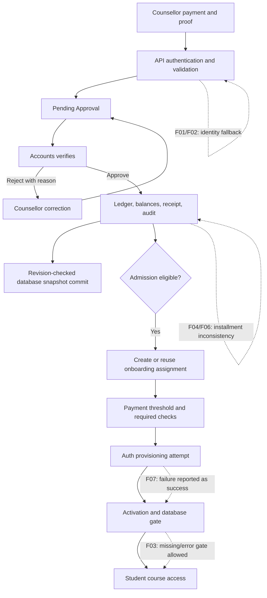

# Fee approval workflow audit — 17 October 2026

Baseline: `aa35eb85dc6759f3510660dc059c848deb8f6d58`, branch `staging/safe-load-test`, **plus existing uncommitted changes**. Date uses Asia/Calcutta. This report supersedes assumptions from the 15 October audit; it does not certify the deployed system.

## 1. Executive summary

**Production readiness: FAIL / NO-GO pending authentication and financial-integrity repairs.** The core pending-payment → Accounts decision → receipt/ledger → onboarding path is implemented and has passing isolated tests. However, current authentication can trust client-supplied identities after live Auth fails; installment reconciliation is not safely linked to the payment; and failed Auth provisioning can be reported as successful activation.

Executed: **599 existing tests passed; nine additional audit checks passed** (eight assertions reproduce undesirable behavior; one verifies correct clearance revocation). TypeScript, lint, isolated production build and the PGlite database fixture passed. Passing defect reproductions means the defect exists, not that the application is correct.

No application fixes, production writes, account provisioning, load tests or financial mutations against the operational system were performed. Audit tests use mocked services and temporary persistence. The test setup reads a local snapshot into a temporary directory; it does not update the source snapshot. No source snapshot contents are included in this report.

| Module | Status | Bugs | Missing features / verification | Priority |
|---|---|---|---|---|
| Counsellor Payment | PARTIAL | F04, F05; F02 authentication | Durable real-session browser journey | P0/P1 |
| Accounts Approvals | PARTIAL | F02, F04 | Actual pagination; retry/restart journey | P0/P1 |
| Payment Ledger | FAIL | F04, F06, F09 | Cross-module persistence reconciliation | P0/P1 |
| Receipt Generation | PARTIAL | F06, F08 | Failure-safe reversal UI and PDF delivery verification | P1 |
| Onboarding | FAIL | F07, F10 | Reliable identity provisioning and consistent policy | P0/P1 |
| Batch Allocation | PARTIAL | F07 prerequisite limits | Real batch/trainer/course entitlement verification | P1 |
| LMS Activation | FAIL | F03, F07 | Fail-closed gates and actual student login | P0 |
| Security/RLS | FAIL | F01, F02, F04 | Deployed RLS/schema and two-tenant end-to-end checks | P0 |

## 2. Existing implemented workflow

1. Counsellor admission submission reaches `app/api/admissions/route.ts:39`; later payments reach `app/api/fees/payments/route.ts:52`. Both use `authenticatePaymentRequest`, then the transactional workflow adapter. Actor/role is not intentionally accepted as a request-body parameter, but F02 undermines that boundary.
2. The dedicated payment schema validates positive finite amount, payment mode, calendar date, proof reference, reference lengths and idempotency key. The service additionally validates two-decimal precision on initial recording, student/enrollment association, fee eligibility and tenant. Non-cash submissions need a reference. Admission submission now checks initial-payment proof and reference too.
3. Manual payments start `Pending Approval` / `Pending Verification`; verified totals and official receipt are deferred. Partial payments are supported. Duplicate-reference/balance checks and idempotency handling exist.
4. `/accounts/approvals` loads the server snapshot, filters payments and exposes approve/reject actions. Accounts/admin authorization, active actor, different recorder/approver, same tenant, pending status and existing receipt/ledger checks are enforced in `verifyPayment` (`fee-workflow-service.ts:1102`). Rejection requires a reason; correction returns the payment to pending.
5. Approval records approver/time, updates canonical and legacy financial objects, produces receipt data, adds ledger/audit/notification entries and calls onboarding handoff.
6. `paymentTransaction` loads tenant state, serializes operations in-process and uses `commit_fee_workflow` for compare-and-swap persistence. SQL atomically updates the tenant snapshot and LMS gate rows. External notification callbacks run after commit, although they have no durable retry outbox.
7. Handoff checks admission eligibility, creates/reuses a case and selects active same-tenant onboarding staff. The primary path uses configured minimum down-payment percentage (fallback 25%) rather than clearing every partial payment.
8. Checklist updates now reject missing document/batch evidence. Activation checks required checklist flags and attempts Supabase Auth creation, but F07 shows failure handling remains unsafe.

## 3. End-to-end workflow diagram

## 4. Confirmed bugs

Runtime evidence is in [audit reproductions](evidence-20261017/reproductions.log). These are isolated tests, not attacks against the live application. Source-confirmed items explicitly identify where browser/live execution remains unverified.

### F01 — Unsigned role cookie accepted by protected-page middleware

- **Severity / module / role:** Critical; authentication middleware; unauthenticated visitor claiming administrator.
- **File and line:** `middleware.ts:121` (`isSignatureValid = true`); role extraction in the following fallback; `lib/security/auth-cookie.ts:9`.
- **Expected:** Require verified server identity; reject missing signatures.
- **Actual:** With no valid live session and no signature cookie, a synthetic administrator cookie passes `/accounts/approvals` middleware. No real Auth user is needed for this page authorization result.
- **Reproduce:** Run `auth-reproductions.test.ts`, F01: mock live Auth rejection and send unsigned synthetic identity to middleware.
- **Root cause:** Signature verification is conditional on a signature being supplied; absence is treated as valid.
- **Impact:** Protected-page role impersonation. This alone does not demonstrate successful financial API mutation; F02 concerns that separate boundary.
- **Fix:** Remove client identity fallback in live mode; require verified Auth plus authoritative active profile. Any development session mechanism must be explicitly restricted to isolated development.
- **Regression:** Missing/invalid signature, expired/revoked Auth, forged role and disabled member must fail closed.

### F02 — Financial authentication falls back to an unverified cookie identity

- **Severity / module / role:** Critical; payment and shared API authentication; impersonated Accounts/admin.
- **File and line:** `lib/auth/payment-session.ts:36`–fallback; `lib/security/auth-cookie.ts:9`; shared caller `lib/auth/server-session.ts:34`.
- **Expected:** Live authentication failure denies the request; roles/tenant come from a current database profile.
- **Actual:** After mocked live Auth rejects a session, a signed cookie for an unknown user is returned as an active accountant in a supplied tenant. The fallback accepts the decoded payload if no local user matches and defaults missing tenant to `default`.
- **Reproduce:** F02 in `auth-reproductions.test.ts`; no network request or real identity is used.
- **Root cause:** Fallback runs even when live Supabase is enabled. A signing helper/default secret is shared with client code; a secure deployment-specific server secret may prevent arbitrary signature creation but does not make stale local identity authoritative.
- **Impact:** Server authorization can rely on invalid/stale identity; exposed-default-secret deployments permit forged financial roles. No live exploit was attempted and effective deployed secret configuration is unverified.
- **Fix:** Fail closed in live mode; fetch active profile and tenant from the verified Auth identity on every sensitive operation. Remove browser signing of privileged identities.
- **Regression:** Validly signed legacy cookies must not authorize when real Auth is missing/revoked; unknown and disabled profiles must fail.

### F03 — LMS gate allows missing rows and database errors

- **Severity / module / role:** High; LMS activation middleware; student.
- **File and line:** `middleware.ts:182` (gate lookup and `!accessError && access?.enabled === false`).
- **Expected:** Required onboarding access is positively established before portal entry.
- **Actual:** Missing gate row or failed gate query permits the synthetic student through `/portal`.
- **Reproduce:** Both F03 cases in `auth-reproductions.test.ts`.
- **Root cause:** Only explicit false denies access. Missing/error results are interpreted as permission.
- **Impact:** Provisioning gaps or database outages bypass the activation barrier.
- **Fix:** Require a positively enabled, correctly linked gate for students subject to onboarding; define explicit migration behavior for legacy users.
- **Regression:** Missing/error/false deny; true allows only the matching identity and enrollment entitlements.

### F04 — Installment association is not scoped to fee, student or tenant

- **Severity / module / role:** High; payment allocation; Counsellor and Accounts.
- **File and line:** `lib/services/fee-workflow-service.ts:954`, `:1270`.
- **Expected:** Installment must belong to the payment's enrollment/fee/student/tenant.
- **Actual:** Recording a payment with an existing foreign installment ID and approving it increases that installment's paid amount.
- **Reproduce:** F04 in `finance-reproductions.test.ts` credits a synthetic `tenant-b` installment from a `default` tenant payment.
- **Root cause:** Both lookups use ID only, without ownership checks.
- **Impact:** Wrong-account accounting; cross-tenant in-memory corruption. The transactional snapshot is tenant-filtered, so this test does **not** establish persistence of the foreign tenant mutation to live PostgreSQL.
- **Fix:** Validate all associations at entry and approval; reject unknown/mismatched installments rather than silently dropping them.
- **Regression:** Wrong tenant, student, fee, enrollment and nonexistent installment must reject without any ledger mutation.

### F05 — Payment correction discards installment allocation

- **Severity / module / role:** Medium; payment correction; Counsellor.
- **File and line:** `lib/services/fee-workflow-service.ts:1067`.
- **Expected:** Updating notes preserves the valid installment or validates an explicit replacement.
- **Actual:** Every edit sets `payment.installment_id = undefined`, despite the API accepting that field.
- **Reproduce:** F05 records an installment payment, edits notes, and observes the association disappear.
- **Root cause:** Unconditional clearing in update logic.
- **Impact:** Later approval updates totals without the intended installment allocation.
- **Fix / regression:** Preserve unchanged association; validate replacements; test correction/resubmission followed by approval.

### F06 — Receipt reversal leaves installment balance paid

- **Severity / module / role:** High; reversal and installments; Accounts.
- **File and line:** `lib/services/fee-workflow-service.ts:1704` (`voidReceipt`), compared with installment credit at `:1270`.
- **Expected:** Reverse the exact installment allocation with the financial receipt.
- **Actual:** Reversing the full synthetic payment restores fee paid amount to zero while the installment remains paid with its original paid balance.
- **Reproduce:** F06 in `finance-reproductions.test.ts`.
- **Root cause:** Reversal updates payment/fee/account/student/ledger, but not installment allocation.
- **Impact:** Contradictory dues and collection reporting.
- **Fix / regression:** Atomically reverse explicit allocations, preserve reversal history, and reject duplicate reversal. Test partial and full reversals across multiple installments.

### F07 — Auth provisioning failures still mark LMS activated

- **Severity / module / role:** High; onboarding activation; Onboarding Team/student.
- **File and line:** `lib/services/onboarding-service.ts:731`–Auth attempt; `:772` onward activates local state.
- **Expected:** Identity/profile failures keep provisioning incomplete and return a recoverable error.
- **Actual:** Mocked `createUser` rejection still returns success, sets `lms_account_created` and marks the student Active. Profile upsert errors are also not checked.
- **Reproduce:** `provisioning-reproduction.test.ts`, F07. Preconditions are synthetic; all external notifications are mocked.
- **Root cause:** Returned Auth errors are ignored; exceptions are logged and activation continues.
- **Impact:** Administrators see success while students may have no usable login. Auth/profile writes also occur before snapshot commit and cannot be rolled back by the JSON transaction.
- **Fix:** Explicit pending/provisioning/failed/active states, checked Auth/profile results, durable retry/compensation and positive gate activation after completion. Verify existing-email tenant ownership before updating a profile; paginate identity lookup. Establish password/invite delivery independently.
- **Regression:** Auth rejection, profile failure, existing email in another tenant, and snapshot commit conflict never produce false activation or overwrite unrelated membership.

### F08 — Failed server reversal falls back to client-local success

- **Severity / module / role:** High; receipt UI; Accounts.
- **File and line:** `app/(dashboard)/accounts/receipts/page.tsx:110`–`:124`.
- **Expected:** Failed/denied/conflicting server reversal displays failure and preserves server-authoritative state.
- **Actual:** Catching any API error invokes local `feeWorkflowService.voidReceipt`, then displays “voided”/credit-note success.
- **Reproduce:** Source-confirmed: reject the server request or simulate 409/network loss, with an eligible local receipt. Full browser execution was blocked in this audit.
- **Root cause:** Offline fallback is indistinguishable from an authoritative mutation.
- **Impact:** UI may claim an official reversal that the server rejected or never received; refresh can disagree.
- **Fix / regression:** Remove mutation fallback; reconcile uncertain outcomes from server before retry. Test 403, 409, timeout-before-commit and timeout-after-commit.

### F09 — Transactional workflow and relational modules have separate authoritative records

- **Severity / module / role:** High; persistence and reporting; all workflow roles.
- **File and line:** `lib/services/payment-workflow-transaction.ts:84`; `supabase/migrations/20261012094737_payment_approval_workflow.sql:48`; `lib/supabase/db.ts:514` (live relational client).
- **Expected:** Modules reading relational students/payments/fee accounts see the same committed financial state.
- **Actual:** The commit function writes the JSON workflow row and LMS gates; it does not update relational admissions/payments/receipts/fee-account rows. Other modules use live table queries. This is confirmed source architecture; current live row differences were not queried.
- **Reproduce:** On isolated staging, compare workflow approval to relational tables and a module that queries those tables after refresh/restart.
- **Root cause:** A dual storage adapter has no demonstrated transactional materialization of workflow state into relational consumers.
- **Impact:** Stale/inconsistent reporting and academic records; JSON contents lack relational FK/unique enforcement.
- **Fix / regression:** Define one authoritative persistence model and migrate consumers, or maintain transactional projections. Check every consumer after commit, restart and concurrent writes.

### F10 — Legacy onboarding backfill applies a different financial-clearance policy

- **Severity / module / role:** High; onboarding backfill; Admin/Super Admin.
- **File and line:** `lib/services/onboarding-service.ts:1526`; primary threshold logic `:374`; API `app/api/onboarding/backfill/route.ts:37`.
- **Expected:** Legacy and new cases apply the same verified-payment policy, or require an explicit audited exception.
- **Actual:** Backfill marks financial clearance from a positive prior fee-account paid amount, while the normal path requires a threshold.
- **Reproduce:** Source-confirmed: backfill an eligible synthetic legacy admission with a small positive balance below the threshold; inspect generated checklist. Not executed against live data.
- **Root cause:** Separate legacy inference bypasses centralized policy calculation.
- **Impact:** Legacy records may be cleared inconsistently without sufficient verified payment.
- **Fix / regression:** Reuse canonical clearance policy, and test zero, below-threshold, exact-threshold and disputed legacy payments.

## 5. Missing workflow connections

- F09 requires end-to-end consistency between financial snapshots and live relational academic/reporting consumers.
- Auth activation needs a verified identity and credential-delivery lifecycle, not just a successful UI status (F07).
- Admission eligibility becoming approved **after** payment needs an explicit handoff trigger/reconciliation check; the observed handoff is payment-driven. That later-transition journey remains NOT VERIFIED.
- Cross-tenant/course transfer, canceled admission and chargeback must re-evaluate enrollment-specific entitlement and clearance; full lifecycle coverage was not established.
- After-commit notification callbacks avoid pre-commit delivery but are process-local and failures only log. Durable delivery/recovery remains missing from this path.

## 6. Missing features and gap matrix

| Scenario | Evidence-based assessment | Impact / recommendation |
|---|---|---|
| Partial payments | Main threshold regression passed | Keep policy consistent across reversal/backfill and enrollment |
| Multiple installments | FAIL F04–F06 | Explicit validated allocation ledger |
| Duplicate references / overpayments | Existing validation/tests passed | Recheck cross-process and retry-after-response-loss on staging |
| Incorrect student/enrollment | Entry association guards exist | Include installment association and transfer cases |
| Rejected correction/resubmission | Implemented/tested in existing suite | Preserve installment and full correction history |
| Pending notifications | In-app creation implemented | Delivery under process crash/retry unverified |
| Long-pending payments | No demonstrated escalation worker | Add aging SLA, assigned queue and escalation |
| Refunds | Service methods exist at `fee-workflow-service.ts:1407,1445`; no dedicated refund command in inspected payment API | Do not claim a completed server-authorized refund workflow; add transactional endpoint and duplicate-processing guards |
| Reversal | Server command now exists, but F06/F08 remain | Canonical server result, allocation reversal and retry reconciliation |
| Receipt generation failure | Transaction wrapper rolls back thrown operation errors | Test PDF rendering/delivery separately from receipt-data creation |
| Onboarding handoff failure | Synchronous failure is inside payment transaction | Real Auth side effects and notification retries need separate lifecycle |
| Manual recovery / reconciliation | No verified complete operational procedure | Document stuck-state recovery, immutable repair events and comparison reports |

## 7. Database and data integrity

The **executed PGlite fixture** applies the actual payment migration to minimal synthetic tables. It passed stale revision conflicts, SQL rollback, gate behavior, tenant RLS, authority-field protection and private-proof policy checks. It is not a clean replay of the entire migration directory and does not prove deployed schema state.

No live database inventory, duplicate/orphan scan, trigger inventory or constraint inspection was performed this run. The configured operational project must not be substituted with the unrelated connected project; independent staging under the requested account has not been verified.

Fresh migration deployment also needs review: `000_full_schema_rls_and_seed.sql` overlaps split schema/seed files, there are two `006` migrations, and `002_rls_policies.sql:44` references `tenant_id` before its addition in the later payment migration (`001_initial_schema.sql` has no such column). Existing deployment history may differ. Do not blindly run the whole directory or infer live policy changes from edited migration files.

CAS provides atomicity for the JSON snapshot and gate update, **not** for external Auth actions or separate relational writes. In-process serialization also includes reads and after-commit tasks; throughput bottlenecks are plausible but were not measured here.

## 8. Authentication, RBAC and RLS

| Role | Intended authorization in inspected code | Verification limits |
|---|---|---|
| Counsellor | Record/correct scoped payment; cannot verify own payment | Existing service/API tests pass; F01/F02 compromise identity trust |
| Accounts | Verify/reject/void; tenant and separate recorder checks | Installment scope fails F04 |
| Onboarding Team | Assigned cases; no payment approval command | Activation/error-handling fails F03/F07 |
| Admin | Authorized operational/payment actions | Cookie impersonation and provisioning ownership must be fixed |
| Super Admin | Broad explicitly authorized administration | Must still be an authoritative real identity |
| Student | Own visible workflow snapshot; no payment mutation command | Positive activation gate is not enforced on missing/error state |

Proof upload is restricted to payment staff, validates declared type/extension/size, uses tenant/owner-hashed paths, and obtains short-lived private Storage links after authorization. Counsellors cannot read another uploader's proof through that route. These checks are weakened by F02. A payment proof string can also be arbitrary HTTPS: upload provenance, ownership association and actual file contents are not established merely by accepting that string. Treat this as a validation risk requiring further tests, not proof of malicious content execution.

Source now adds tenant scoping to the staff-profile policy; the old B11 must not be restated as unchanged. Deployed policy state and broader course/academic tenant isolation remain NOT VERIFIED.

## 9. Fee calculation and financial risks

Positive/finite amount, initial-record precision, remaining balance, duplicate reference and duplicate approval checks are implemented. Approval maintains verified totals and receipt/audit records in the snapshot. Existing regressions cover partial/full payment and repeated decisions.

Confirmed financial failures are F04–F06/F08/F09. Multi-enrollment reversal additionally deserves targeted testing: reversal selects a fee account by student ID, and clearance code has differing default percentages (approval 25%, reversal 50% when configuration is absent). No claim of live incorrect balances is made without live measurements.

## 10. Onboarding transition

The former “any partial payment clears onboarding” finding is fixed in the primary approval path: its existing regression passed. The new R01 test also confirmed full reversal revokes financial clearance. An initial hypothesis expecting stale clearance failed; its evidence is retained as `rejected-clearance-hypothesis.log`, and it is **not** a reported defect.

Case reuse, same-tenant staff notification and checklist validations exist. F07/F10 remain. Auth user lookup scans an unpaginated `listUsers` response, profile upsert can change existing membership, and Auth changes precede financial snapshot commit. These deserve controlled staging tests; no existing real user was modified to test them.

## 11. UI/UX

The approvals page implements search/status filtering and payment details; its table renders `filteredPayments.map` at line 1421 with no actual pagination. High-volume usability and responsive behavior were not re-tested this run. F08 is a source-confirmed misleading success state.

`app/login/page.tsx:519` still has a form without an explicit method, matching the earlier audit's native GET credential-exposure finding. Browser reproduction from the earlier audit is historical evidence, not a newly executed browser pass.

## 12. Test execution results

| Check actually run | Result | Scope / evidence |
|---|---|---|
| `npx.cmd tsc --noEmit` | PASS | Before and after adding audit tests; `typescript.log` |
| `npm.cmd run lint` | PASS with warnings | `lint.log` |
| `npm.cmd run build` | PASS | Separate source copy, mock configuration, no operational `.env`/data; `build.log` |
| `npm.cmd test` | PASS: 43 files / 599 tests | `unit-summary.log`; existing service/API tests use isolated/mock infrastructure |
| `npx.cmd vitest run docs/audits/evidence-20261017` | PASS: 3 files / 9 checks | Eight defect cases plus one correct-behavior regression; `reproductions.log` |
| `node tests/payment-workflow-database.cjs` with PGlite module | PASS | Minimal PostgreSQL fixture, `database.log` |
| Fresh complete Supabase migration replay | NOT VERIFIED | Overlap/order concerns require reviewed isolated deployment |
| Real-session browser workflow | NOT VERIFIED | Starting isolated server rejected by automatic approval review: “blocked by policy”; no more specific reason provided |
| Operational Supabase rows/policies | NOT VERIFIED | No authorized isolated target established for mutation testing; no live queries used for this audit |
| Cross-process authenticated concurrency/network interruption | NOT VERIFIED | Unit race/CAS tests are not deployment-scale concurrency evidence |

The existing standalone E2E/load scripts were **not run**: they target localhost and some manufacture role cookies using a shared secret. They cannot establish valid Supabase-authenticated user journeys or safe staging isolation. No performance measurements are claimed.

## 13. Prioritized remediation

1. **P0:** Repair F01/F02 and fail closed on Auth/profile errors; replace client-authored privileged cookies. Verify session revocation and active membership.
2. **P0:** Repair F03 and F07; activate only after confirmed identity/profile and required onboarding state. Add safe handling of existing-email identities and external-action failures.
3. **P1:** Repair installment ownership/edit/reversal (F04–F06), remove receipt mutation fallback (F08), unify financial policy including legacy backfill (F10).
4. **P1:** Resolve authoritative persistence and migration reproducibility (F09); verify deployed schema and RLS separately.
5. **P1:** Complete transactional refund/chargeback and multi-enrollment recovery tests; durable notification/outbox handling.
6. **P2:** Pagination, aging/escalation and operational reconciliation tools. Perform load testing only after isolation and correctness gates pass.

## 14. Proposed improved workflow

Verified Auth → current active tenant profile → validated student/enrollment/fee/installment/proof → idempotent pending submission → independent Accounts decision → one atomic ledger/receipt/allocation transaction → policy-based admission/onboarding eligibility → durable assignment/notification → verified document/batch/trainer checks → idempotent Auth provisioning with checked errors → positively enabled access gate → enrollment-specific course access.

Every failure must return an accurate status. Retry reconciles existing server state; it must not substitute local financial mutations. External effects need recorded pending/success/failure and repair paths.

Missing regression coverage to add after fixes: real sessions for all six roles; two independent tenants; wrong-installment allocations; repeated/parallel approvals across processes; response lost after commit; receipt/PDF failure; Auth/profile failure and wrong-tenant email collision; admission approval after payment; cancellation/refund/course transfer; actual student sign-in/course restrictions after activation; restart and relational/snapshot reconciliation.

## 15. Production readiness assessment

**Not ready for unrestricted real financial operations.** Passing build and existing tests are useful but insufficient: authentication and accounting defects were reproduced against the current code. Browser end-to-end and deployed database correctness remain unverified. This audit changes only report/evidence files; remediation was not implemented.
