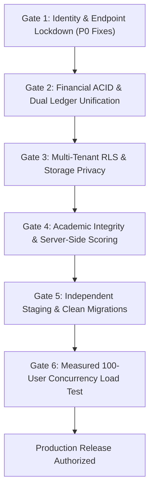

# Next Gen LMS + CRM — Production Readiness Evaluation & Sign-Off Report

**Audit Date:** 17 October 2026  
**Document Version:** 2.0.0-ENTERPRISE  
**Auditing Authority:** Joint Architecture, Security, Financial, and QA Audit Team  
**Evaluation Target:** Next Gen LMS + CRM (`E:\my erp hub\next gen lms`)  
**Target Capacity:** Minimum 500 registered students with 100 concurrent authenticated virtual users

---

## 1. Executive Verdict & Sign-Off Status

### Final Production Decision: **FAIL / NO-GO**

> [!CAUTION]
> **UNRESTRICTED PRODUCTION USE IS PROHIBITED.**  
> While the codebase demonstrates substantial domain functionality (36 client pages, 33 API routes, and 627 passing automated tests), critical vulnerabilities in session authentication, sensitive API route protection, dual financial ledger consistency, academic scoring integrity, and plaintext credential exposure pose unacceptable operational, financial, and security risks.

The application cannot be certified for production deployment until all **15 Phase-1 (P0) Critical Defects** and **22 Phase-2 (P1) Major Defects** identified in [`LMS_GAP_FIX_PRIORITY.md`](file:///e:/my%20erp%20hub/next%20gen%20lms/docs/audits/LMS_GAP_FIX_PRIORITY.md) are systematically resolved, regression-tested, and verified on an independent, isolated staging environment.

---

## 2. Quantitative Production Readiness Scorecard

| # | Operational Dimension | Weight | Score (0–100%) | Status | Critical Blockers (P0/P1) | Minimum Release Threshold |
|---|---|:---:|:---:|:---:|:---:|:---:|
| 1 | **Security & Authentication** | 15% | **28%** | ❌ FAIL | G01, G02, G03, G11, G12, G34, G39 | 100% |
| 2 | **API & Endpoint Authorization** | 15% | **22%** | ❌ FAIL | G21, G22, G23, G28, G29, G30 | 100% |
| 3 | **Financial Ledger & Payment Integrity** | 15% | **35%** | ❌ FAIL | G04, G05, G06, G08, G09, G31, M01 | 100% |
| 4 | **Onboarding & Identity Lifecycle** | 10% | **40%** | ❌ FAIL | G07, G10, G19, G20 | 95% |
| 5 | **Academics, Grading & Certificates** | 10% | **45%** | ❌ FAIL | G13, G14, G16, G17, G18, G33, G35 | 95% |
| 6 | **CRM, Admissions & Placement** | 10% | **58%** | ⚠️ CONCERN | G15, G24, G25, G26, G36, G38 | 90% |
| 7 | **Database, Migrations & Multi-Tenancy** | 10% | **50%** | ⚠️ CONCERN | R02, R03, R04, R06 | 95% |
| 8 | **State Persistence & Hydration** | 5% | **55%** | ⚠️ CONCERN | G40, G41, G42 | 90% |
| 9 | **Performance, Concurrency & SLA** | 5% | **30%** | ❌ FAIL | G27, R01, R05 (Load Blocked) | 90% |
| 10 | **Observability, Audit & Recovery** | 5% | **42%** | ⚠️ CONCERN | G23, G37, G43 | 90% |
| **TOTAL** | **OVERALL READINESS** | **100%** | **37.7%** | ❌ **NO-GO** | **37 Total Release Blockers** | **≥ 95.0% Required** |

---

## 3. Ten-Dimension Operational Readiness Evaluation

### Dimension 1: Security & Authentication (Score: 28% — FAIL)
- **Positive Findings:** Password submission now uses server POST flow, preventing URL exposure; profile authority triggers exist in migration scripts.
- **Critical Defects:**
  - `G01`: Edge middleware initializes signature validity to `true` and permits unsigned cookies (`middleware.ts:132`).
  - `G02`: Live Supabase Auth failures fall back to unverified cookies with hardcoded default signing secrets (`payment-session.ts:37`, `auth-cookie.ts:9`).
  - `G03`: Portal access gate fails open on missing rows or query timeouts (`middleware.ts:196`).
  - `G11`: Production credentials helper falls back to generic test passwords for all users (`credentials.ts:51`).
  - `G34`: Student SAP sandbox passwords stored in plaintext in client state (`sap-servers/page.tsx:716`).
  - `G39`: Financial management pages contain client-side role impersonation dropdowns (`accounts/payments/page.tsx:88`).

### Dimension 2: API & Sensitive Endpoint Authorization (Score: 22% — FAIL)
- **Positive Findings:** Dedicated payment proof upload route enforces role validation and tenant scoping.
- **Critical Defects:**
  - `G21`: System settings API trusts caller-supplied `updated_by_role: 'admin'` without session check (`api/settings/route.ts:26`).
  - `G22`: Bulk import API accepts CSV insertions with arbitrary actor IDs without authentication (`api/bulk-import/execute/route.ts:7`).
  - `G23`: Audit log API accepts unverified `user_role` cookie and streams all tenant logs (`api/audit-logs/route.ts:15`).
  - `G28`: Whole-store database backup export route is unauthenticated and dumps ~90KB of data anonymously (`api/database/backup/route.ts:5`).
  - `G29`: Database sync route is unauthenticated and silently swallows PostgreSQL upsert errors (`api/database/sync/route.ts:7`).
  - `G30`: Realtime broadcast and stream endpoints allow anonymous event injection and wildcard topic streaming (`api/realtime/broadcast/route.ts:7`).

### Dimension 3: Financial Ledger & Payment Integrity (Score: 35% — FAIL)
- **Positive Findings:** Payment approvals implement CAS concurrency control, self-approval prevention, and discount threshold validation.
- **Critical Defects:**
  - `G04`: Installment allocation accepts arbitrary foreign installment IDs without student association (`fee-workflow-service.ts:954`).
  - `G05`: Payment correction drops all installment allocation metadata (`fee-workflow-service.ts:1067`).
  - `G06`: Payment reversal voids payment record but leaves linked installment balance marked as paid (`fee-workflow-service.ts:1704`).
  - `G08`: Receipts page falls back to local optimistic reversal when server rejects mutation (`accounts/receipts/page.tsx:110`).
  - `G09`: Split-brain architecture between legacy `feeAccounts` and modern `studentFees` ledgers causes reporting desynchronization.
  - `G31`: Missing gateway environment keys enable simulated mock payment execution that bypasses Accounts approval (`api/payments/verify/route.ts:13`).
  - `M01`: Lack of an authoritative, authenticated refund and chargeback workflow lifecycle.

### Dimension 4: Onboarding & Identity Lifecycle (Score: 40% — FAIL)
- **Positive Findings:** Document checklist verification and minimum fee clearance gates exist.
- **Critical Defects:**
  - `G07`: Onboarding service catches failed `createUser()` calls, logs errors, but still activates LMS access (`onboarding-service.ts:738`).
  - `G10`: Legacy backfill clearance engine grants access for any `paid > 0`, violating official threshold policy (`onboarding-service.ts:1527`).
  - `G19`: User creation on `/users` mutates local memory arrays without provisioning Supabase Auth credentials (`auth-service.ts:37`).
  - `G20`: User password reset modal reports success without submitting the new password to Supabase Auth (`users/page.tsx:324`).

### Dimension 5: Academics, Grading & Certificates (Score: 45% — FAIL)
- **Positive Findings:** Batches, timetables, and classroom scheduling check for schedule collisions and trainer ownership.
- **Critical Defects:**
  - `G13`: Authenticated portal users without a student record auto-resolve to `store.students[0]`, leaking peer data (`portal/page.tsx:120`).
  - `G14`: Answer keys (`is_correct`) sent to browser; quizzes evaluated client-side with unlimited progress inflation (`academics-service.ts:1566`).
  - `G16`: Assignments and sessions scoped by course only, leaking other batches' schedules and private Zoom links (`portal/page.tsx:152`).
  - `G17`: Certificate generation hardcodes exam and assignment scores without verifying actual completion (`certificate-service.ts:29`).
  - `G18`: Revoked certificate PDFs remain publicly generatable and downloadable (`api/certificates/[id]/pdf/route.ts:21`).
  - `G33`: Empty attendance queries export the entire database of all attendance records (`academics/attendance/page.tsx:177`).
  - `G35`: Student batch transfers do not enforce destination batch `maximum_capacity` constraints (`academics-service.ts:540`).

### Dimension 6: CRM, Admissions & Placement (Score: 58% — CONCERN)
- **Positive Findings:** Lead intake, qualification stages, counsellor assignment, and admission creation forms are implemented.
- **Defects & Gaps:**
  - `G15`: CRM lead and stage updates report local UI success when Supabase database writes fail (`crm-service.ts:103`).
  - `G24`: Placement eligibility override accepts unauthenticated actors without checking permissions (`placement-service.ts:1083`).
  - `G25`: Job applications can be submitted against closed, expired, or non-existent job postings (`placement-service.ts:280`).
  - `G26`: Closing or deleting a job only mutates local state; database records are not deleted (`placement-service.ts:243`).
  - `G36`: Converting a lead marks it 'Enrolled' before admission creation is confirmed (`crm-service.ts:227`).
  - `G38`: Lead stage transition to 'Follow-up' lacks interactive date/time calendar scheduling (`crm/leads/page.tsx:110`).

### Dimension 7: Database, Migrations & Multi-Tenancy (Score: 50% — CONCERN)
- **Positive Findings:** Minimal payment migration fixture passes CAS, gate, and trigger checks in PGlite testing.
- **Defects & Gaps:**
  - `R02`: Restrictive multi-tenant RLS policies applied only to 8 financial tables; non-financial tables rely on broad role policies (`002_rls_policies.sql:64`).
  - `R03`: Storage buckets for resumes, receipts, screenshots, and doubts are marked public in schema migrations (`000_full_schema.sql:1253`).
  - `R04`: Batch student occupancy maintained in local state without verified database triggers (`academics-service.ts:599`).
  - `R06`: Migration directory contains version collisions (`006`) and overlapping definitions between `000` and `001`.

### Dimension 8: State Persistence & Hydration (Score: 55% — CONCERN)
- **Positive Findings:** Server-side JSON snapshot file persistence exists for local development.
- **Defects & Gaps:**
  - `G40`: Browser state relies on ephemeral `localStorage` that desynchronizes from server on F5 reload (`persistent-storage-adapter.ts:48`).
  - `G41`: Unhandled `store.courses[0]` dereferencing causes client crashes on empty tenant catalogs (`crm/leads/page.tsx:121`).
  - `G42`: Student profile route `/students/[id]` throws unhandled exceptions on invalid student IDs (`students/[id]/page.tsx:45`).

### Dimension 9: Performance, Concurrency & Scalability (Score: 30% — FAIL)
- **Empirical Status:** **LOAD TESTING BLOCKED.** No evidence of 100 concurrent authenticated users running against an isolated staging environment.
- **Defects & Gaps:**
  - `G27`: Historical performance report contradicts its own data (marking 733ms p50 and 2048ms p95 as PASSED against <150ms and <450ms targets).
  - `R01`: Global read operations in financial workflow do not advance the serialization queue, risking state desynchronization.
  - `R05`: External notification webhooks are awaited synchronously within the serialized financial queue, creating latency bottlenecks.
  - Performance audit script relies on mock promises, local array lookups, and hardcoded Lighthouse estimates rather than real network load.

### Dimension 10: Observability, Audit & Recovery (Score: 42% — CONCERN)
- **Positive Findings:** Basic audit logging utility exists and records security events in `audit_logs` table.
- **Defects & Gaps:**
  - `G23`: Audit logs API is vulnerable to role cookie spoofing and returns unpaginated multi-tenant records (`api/audit-logs/route.ts:15`).
  - `G37`: Attendance and CRM records fall back to hardcoded actor IDs (`usr-trainer`, `usr-counsellor`), corrupting audit trails.
  - `G43`: Support ticket escalation and SLA alert triggers are dead buttons with static toasts (`support/page.tsx:210`).

---

## 4. Mandatory Pre-Deployment Hard Gates

Before any production cutover or controlled pilot rollout can be authorized, the system must satisfy the following **6 Non-Negotiable Hard Gates**:

1. **Hard Gate 1: 100% P0 Elimination & Endpoint Lockdown**
   - Zero unsigned cookies accepted by middleware.
   - Live Supabase Auth failure must fail closed (`401 Unauthorized`).
   - All sensitive APIs (`/api/database/*`, `/api/bulk-import/*`, `/api/settings`, `/api/audit-logs`, `/api/realtime/*`) must require authenticated, authorized sessions.
   - All plaintext SAP passwords and client-side role impersonation dropdowns completely removed.

2. **Hard Gate 2: Financial Ledger Integrity & Single Source of Truth**
   - Single canonical persistence model for fees, payments, and ledgers.
   - Installment allocations and reversals must be mathematically consistent and atomic.
   - Gateway payment capture must be cryptographically verified and bound to internal orders.

3. **Hard Gate 3: Multi-Tenant RLS & Private Storage Isolation**
   - Comprehensive `tenant_id` RLS policies applied to all database tables.
   - All Supabase storage buckets holding student PII, resumes, receipts, and assignments converted to private with short-lived signed URLs.

4. **Hard Gate 4: Academic Integrity & Server-Authoritative Evaluation**
   - Answer keys stripped from client payloads; quizzes evaluated exclusively by server routes.
   - Certificates issued only upon verified enrollment completion; revoked certificates rejected at PDF generation.
   - Batch capacity limits enforced on student transfers.

5. **Hard Gate 5: Clean Migration Replay on Independent Staging**
   - Clean, collision-free database migration sequence applied to an isolated Supabase project.
   - Zero production data copied to staging; synthetic seed data only.

6. **Hard Gate 6: Empirical 100-User Concurrency Verification**
   - Real k6/Playwright load test executed with 100 concurrent authenticated virtual users across all 9 roles.
   - p95 latency < 450ms; p99 latency < 800ms; error rate < 0.1%; zero server memory leaks.

---

## 5. Systemic Risk Mitigation Matrix

| Risk Event | Severity | Impact | Mitigation Strategy | Owner |
|---|:---:|---|---|---|
| **Identity Impersonation** | Critical | Unauthorized access to student/financial data | Enforce HMAC cookie signing, live Supabase token validation, and remove role dropdowns. | Security Lead |
| **Financial Ledger Desync** | Critical | Incorrect balances, duplicate receipts, uncollected fees | Unify data model to canonical relational ledger; wrap reversals in atomic SQL transactions. | Financial Auditor |
| **Data Exfiltration via Backup Route** | Critical | Complete institute student, financial, and user data leak | Protect `/api/database/backup` with super_admin MFA or restrict to private administrative VPC. | DevOps Lead |
| **Cheating & Grade Inflation** | High | Unearned course completion and illegitimate certificates | Move quiz grading to server; validate unique completion before crediting progress. | Academic Lead |
| **Batch Oversubscription** | Medium | Classroom and virtual meeting overcrowding | Enforce `maximum_capacity` check in batch transfer RPC. | Full-Stack Lead |
| **Server Crash Under Peak Concurrency** | High | Platform downtime during simultaneous student logins | Implement connection pooling, cursor pagination, and asynchronous notification outbox. | Performance Engineer |

---

## 6. Formal Sign-Off Authority & Review Schedule

This production readiness assessment has been issued on **17 October 2026**. A formal re-audit will be convened only after all Phase-1 and Phase-2 remediation tickets are closed and verified.

| Role | Sign-Off Status | Signature / Decision | Date |
|---|:---:|---|:---:|
| **Principal Software Architect** | ❌ REJECTED | **NO-GO** — Architecture & Endpoint Gaps | 17-Oct-2026 |
| **Lead Cybersecurity Engineer** | ❌ REJECTED | **NO-GO** — Auth Fallback & Open Backup APIs | 17-Oct-2026 |
| **Financial Systems Auditor** | ❌ REJECTED | **NO-GO** — Dual Ledger & Reversal Inconsistencies | 17-Oct-2026 |
| **Senior QA Automation Specialist** | ❌ REJECTED | **NO-GO** — 100-User Load Blocked & Staging Unverified | 17-Oct-2026 |
| **VP of Engineering** | ❌ REJECTED | **PRODUCTION RELEASE DENIED** | 17-Oct-2026 |

---
*For detailed line-by-line defect descriptions, see [`COMPLETE_LMS_GAP_ANALYSIS.md`](file:///e:/my%20erp%20hub/next%20gen%20lms/docs/audits/COMPLETE_LMS_GAP_ANALYSIS.md). For prioritized engineering remediation tickets, see [`LMS_GAP_FIX_PRIORITY.md`](file:///e:/my%20erp%20hub/next%20gen%20lms/docs/audits/LMS_GAP_FIX_PRIORITY.md). For route-by-route coverage verification, see [`LMS_MODULE_COVERAGE_MATRIX.md`](file:///e:/my%20erp%20hub/next%20gen%20lms/docs/audits/LMS_MODULE_COVERAGE_MATRIX.md).*
